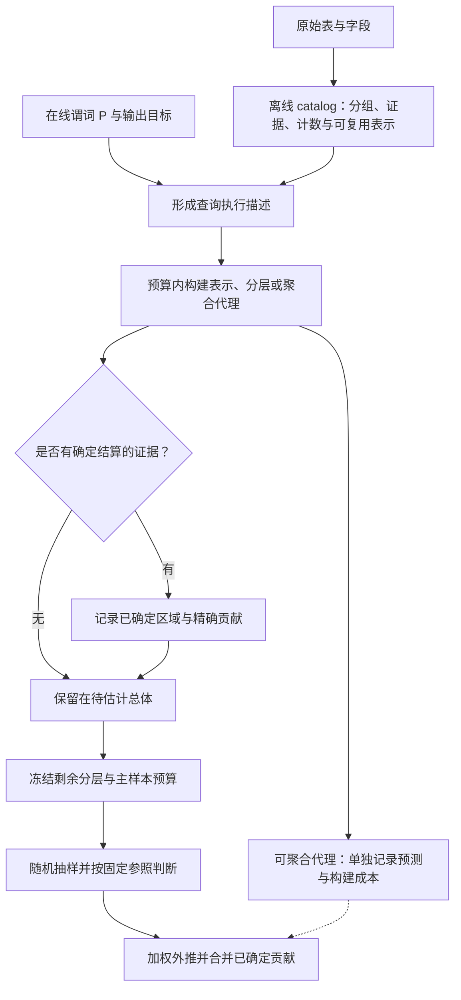

# 围绕 Decision Model 三种 primitive 的语义连接原型

日期：2026-11-23。状态：讨论草案；尚未确定为实现方案或实验协议。

本文以预算内的语义连接基数估计为主路径：先利用 Decision Model（DM）形成语义表示、分层或聚合代理，再在预算内检查样本并估计总数。具备充分证据时，可以精确结算局部区域；不把剩余区域默认穷举到底。完整连接执行和多表执行接口另行讨论，不作为 SemCEB 已覆盖的能力。

先假设 DM 对信息充分的问题判断正确，并将一次容量范围内的模型调用视为一个基本操作。这个理想化不意味着摘要对任意查询充分，也不赋予概率代理精确性。本文补充最小的固定预算抽样接口，详细校准、置信区间和自适应预算机制留待后续；没有实现系统或运行实验，所有算例都是教学构造。

核心设想是：**离线 catalog 准备可复用的数据组织与语义数值表示；在线根据查询谓词，用三种 primitive 构建更有用的估计结构，并限制表示补充与参考判断的总预算。** 块级确定计数和精确等级连接是有适用条件的加速路径，不是开放谓词下默认可用的能力。与 SemStats 的重合及候选区别见第 7 节。

理解概率表示可先读第 3 节和第 5.5 节；理解主流程可读第 4.4 节和第 6 节算例；执行复杂度与多表接口分别见第 5.4、8 节。

## 1. 从“每对问一次”到“选择判断单位”

设左右输入为 $R$、$S$，每条记录有唯一行标识。查询已经给出自然语言谓词 $P(r,s)$、允许读取的字段及参照判定方式。以下 $P(r,s)$ 表示按这个固定参照取得的二元结果。连接结果和基数分别为：

$$
J_P=\{(r,s)\in R\times S:P(r,s)=1\},
\qquad C_P=|J_P|.
$$

最直接的执行方式是对每个记录对调用一次 noul，判断 $P(r,s)$。若 $|R|=n$、$|S|=m$，单问题、逐对调用需要 $nm$ 次模型调用。

DM 原型希望允许另外几种判断单位：

- 对一组候选进行比较，决定下一步访问哪个分支。
- 对一个数据块对进行判断，决定整块跳过、计数或细分。
- 对每条记录建立查询相关的有序表示，再用普通排序与计数处理连接。
- 对两侧记录分别形成状态统计，用兼容矩阵聚合计算连接代理。

这些方式依赖不同的关系结构。估计模式在无法分解时退回预算内的随机配对抽样；只有明确选择完整执行模式时，才退回逐对穷举。

需要区分三种交付目标：

| 目标 | 必须交付什么 | 剩余区域怎样处理 |
| --- | --- | --- |
| 预算内基数估计：本文主路径 | 基数点估计、覆盖范围和成本记录 | 抽样外推或由可聚合代理估计；不默认穷举 |
| 精确计数：条件加速或诊断参照 | 精确基数 | 无法整体结算的区域须完整处理 |
| 完整连接枚举：扩展目标 | 全部匹配记录对或可继续处理的关系表示 | 保留身份、重数和后续需要的字段 |

三者共享部分机制，但预算、停止条件和输出接口不同。局部 FULL 块在最终计数时可直接加块大小；多表中间节点不能只交付一个总数，见第 8 节。

输入任一侧为空时直接返回 0；其余块级讨论仅针对非空块。相同文本仍按不同记录计数。自连接默认覆盖有序记录对，也包含同一记录与自身的配对，除非原查询明确要求排除；不擅自使用对称性将计数减半。

## 2. 理想假设与调用成本

### 2.1 本文采用的抽象

先采用以下假设：

1. 查询谓词、引用字段、参数方向和缺失信息约定已经明确。
2. 在理想判定路径中，DM 对输入信息足以回答的问题给出与固定参照一致的答案；概率代理路径另行标记，不继承这个等价保证。
3. 一次容量范围内的请求成本记为 $1$，即 $O(1)$；本轮不以数据库 IO 作为主要成本单位。
4. 普通程序负责分组、排序、集合操作、行数相乘和结果累加。
5. 离线阶段默认看不到具体测试查询，在线产生的查询专用表示计入在线工作。
6. 输入请求的在线预算是外部给定的约束，涵盖查询专用表示、证据补充、分层、先导判断及主样本判断；本文不指定正式实验预算。

第 2 项不意味着有限摘要拥有原文中全部信息。例如摘要只写“钢笔”，就不能据此确定某个专用墨囊是否适配该系列的所有型号。这属于输入信息是否充分的问题；即使先假设模型无误，也需要保留。

本文区分三个层次：确定标签表示一个已定义的事件是否成立；模型输出 $q$ 是该事件的数值预测；经额外假设或检查后，$q$ 才可能被解释为相应条件概率。确定标签的计数、代理数值的代数求和、对真实基数的统计推断是不同结论，不能相互替代。

固定数据和参照以后，真实标签及基数是固定量。若引入概率解释，需要说明随机对象和共同条件信息；模型的事件分数也不能当作抽样纳入概率使用。

一次调用可以处理一批选项或多个问题；不把 choice 的每个输出槽位机械地算成一次独立模型调用。同时，保留单次请求的输入容量 $L$、选项容量 $B_{\max}$ 和问题容量 $Q$，不假设任意大的表都能放进一次请求。

### 2.2 调用次数、问题数量和交互轮次

先记录三个量：

| 量 | 含义 | 用途 |
| --- | --- | --- |
| 请求数 | 发起多少次模型请求，包括在线新增表示和状态判断 | 本文的主要理想成本 |
| 问题数与输入规模 | 请求内有多少问题、选项和材料 | 描述一次请求承担的工作 |
| 依赖轮次 | 后续问题有多少必须等待前一答案 | 区分可并行批处理与顺序路由 |

例如，多个 noul 可以共享同一条左记录并放入一批请求。它仍在逐对判断，但请求数不再等于配对数。比较路由、块级或等级算子时，逐对基线也应获得相同的批处理与共享输入能力。

这个模型先帮助讨论计算形态，不声称现实中所有请求等时。实际延迟、token、GPU 工作量和缓存占用留待实现阶段测量。离线成本、在线成本分别记录；跨查询摊销需要明确工作负载。

## 3. 三种 primitive 的语义分工

| Primitive | 输入与输出语义 | 本原型中的用途 |
| --- | --- | --- |
| choice | 给定候选或状态，输出集合内选择及归一化分布 | 路由、分类、联合状态、块状态选择、集合内比较 |
| noul | 针对一个明确条件，输出是非判断的数值 | 可重叠事件、复合条件、配对验证、存在性或全称检查 |
| score | 根据有序等级描述，输出等级分布及等级加权值 | 等级软计数、累计分布、范围计数 |

接口依据是本地 Kev 的 TypeSafe 兼容接口：choice 返回选项分布，noul 返回真值分数，score 返回有序等级分布及其加权等级。它说明本文使用的接口含义，不证明所有 DM 实现具有相同内部机制。[来源 1]

choice 的多个概率对应同一个选择问题，不等于多条独立的匹配标签。对于“哪件最适合”，即使有三件都满足连接谓词，它也不会自动返回三条匹配边。noul 适合分别检查这些边，不受跨候选归一化总和为 1 的约束。这里先区分接口语义，不讨论实际模型的上下文干扰。

score 的等级顺序由问题定义。把描述分为“简略、一般、详细”，与回答“给定两份描述，哪份更详细”仍是两种任务；只有建立两者之间的关系以后，才能用等级替代相应的配对判断。

同一种底层模型可能实现这三种接口，原型也不要求它们在数学上无法相互编码。差异在于系统向模型提出什么问题、返回值允许触发什么操作，以及怎样组织一次调用。

### 3.1 谓词概率标量：一个数对应一个明确事件

设 $A_d(r)$ 是第 $d$ 个语义事件，例如“商品主要提供手工材料”或“明确声明适配 X 系列”。noul 给出的原始分数记为 $q_{r,d}\in[0,1]$。它按事件定义读取指定字段，不要求先以向量近邻定义相关性。

这不是用一个标量编码全部语义。选择 $D$ 个问题后，每条记录仍有 $D$ 个分数；区别在于每个坐标有明确的谓词含义。不同事件都取 0.9，不表示它们含义相同。事件定义应绑定输入字段、否定和缺失约定、模型及问题版本。

可以保存软计数：

$$
\widetilde N_d=\sum_{r\in R}q_{r,d}.
$$

这是预测总量。若每个 $q_{r,d}$ 都是固定共同信息下相应事件的条件概率，则期望的线性性赋予它期望计数的解释，不要求记录间独立；但这仍不等于固定数据上已经观测到的真实计数。本文不直接假设 DM 原始分数满足这一概率条件。

embedding 的余弦相似度也可能是标量，但通常没有“满足此事件的概率”这一语义。另一方面，SemStats 的轻量分类器也可以提供数值预测；“可以输出概率”本身不是 DM 独有贡献。

### 3.2 联合状态：不通过边际相乘猜组合关系

设 $A(r)$ 为“是补充装”，$B(r)$ 为“明确适配 X 系列”。可用 choice 定义四个互斥且穷尽的联合状态 $(A,B)\in\{00,10,01,11\}$，得到分布 $q_{00},q_{10},q_{01},q_{11}$。从同一份分布可派生：

$$
\widetilde p(A\land B)=q_{11},\qquad
\widetilde p(A\lor B)=q_{10}+q_{01}+q_{11},\qquad
\widetilde p(A)=q_{10}+q_{11}.
$$

这些是联合预测内部的边际化计算，解释为真实事件概率还需要相应概率语义。不能用两次独立问题得到的 $q_Aq_B$ 自动替代 $q_{11}$；问题分支在计算上隔离，不意味着事件统计独立。分别提问得到的边际也未必与联合 choice 派生的边际一致，不能混用而不说明来源。

例如，教学分布 $(q_{00},q_{10},q_{01},q_{11})=(0.1,0.2,0.1,0.6)$ 给出 $A$ 的预测为 0.8、$B$ 为 0.7、$A\land B$ 为 0.6。两个边际的乘积 0.56 并不等于这个联合预测。

若只需一个复合条件，可直接用 noul 询问 $A\land B$；若希望复用多个边际和组合，联合 choice 更有意义。对 $D$ 个二元事件完整展开需要 $2^D$ 个状态，因此只考虑少量高价值组合，且服从选项容量 $B_{\max}$。选择哪些组合、怎样复用，是候选研究问题。

四状态以二元事件及其缺失约定已经定义为前提。例如“未提及适配 X”可以在明确的文本证据规则下使 $B$ 为假；“当前摘要看不清”则是信息不足，不能据此当作 $B$ 为假。需要访问原文或保留未解决区域。

### 3.3 等级分布：保留顺序与分布，而不只保留均值

score 提供等级 $k\in\{0,\ldots,G-1\}$ 的分布 $q_r(k)$。保存左右表的软直方图：

$$
H_R(k)=\sum_{r\in R}q_r(k),\qquad
H_S(k)=\sum_{s\in S}q_s(k).
$$

对于等级严格比较，可低成本计算代理总量：

$$
\widetilde C_{\mathrm{ord}}
=\sum_k H_R(k)\left(\sum_{\ell<k}H_S(\ell)\right).
$$

它等于所有记录对的“左等级高于右等级”的乘积分布代理之和。仅当等级表示足以定义原关系，且硬标签或概率依赖条件相应成立时，才有更强的计数或概率解释。不同记录的边际分布相乘也不是无条件成立的真实联合概率；自连接同一记录的等级不能当成两次独立抽取。

均值相同的等级分布可能产生不同的比较结果，因此不能先把分布压成均值，再假设保留了上述比较信息。原始语义的成对比较能否由统一标尺表达，是独立于模型评分正确性的结构条件。

## 4. 离线 catalog 与在线查询处理

### 4.1 离线准备什么

离线 catalog 是可复用材料，候选内容如下：

| 内容 | 例子 | 在线作用 |
| --- | --- | --- |
| 表与字段描述 | 商品标题、特征、评论正文；字段来源与缺失情况 | 限定谓词可读取的信息 |
| 行级表示 | 商品角色、材料、用途、规格等特征 | 单侧筛选、分组、等级计算的输入 |
| 事件与联合状态 | 有定义的 noul 分数、choice 联合分布、score 等级分布 | 软计数、组合条件与可聚合连接代理 |
| 层级与分组 | 商品类型、系列、规格的层级；每组成员与行数 | choice 路由和块级判断 |
| 组的证据 | 属性覆盖情况、原文入口、成员差异、代表样本 | 判断摘要是否足够，必要时访问细节 |
| 输入复用资源 | 可复用的文本布局；服务支持时的共享状态 | 减少重复处理相同材料 |
| 算子适用描述 | 哪些表示能支持角色筛选、等级比较、型号适配 | 在线选择执行方式 |

并非每项都必须实现。尤其是跨请求模型状态或 KV 缓存，只能在具体服务支持时使用，不能把它当作通用 DM 接口保证。

代表样本可以帮助比较和安排访问顺序，但单靠代表样本不能证明整个组全匹配或全不匹配。原型需要区分“抽样概况”和“足以支持整组判断的证据”。

查询无关摘要不保证支持任意在线谓词。若两个原始块具有同一摘要，但对某个 $P$ 的整块答案不同，那么任何模型都不能仅凭该摘要区分它们。原型需要明确两条路径：

- **限定谓词族的确定路径**：预先声明支持的事件和组合方式，保存相应充分状态、成员覆盖信息及有效性记录；在线确认 $P$ 可由这些状态表达。
- **开放谓词的估计路径**：摘要可能有损，块标签是预测或分层依据；缺乏参照语义下的证据时，整个区域仍属于待估计总体。

确定路径的证据可以来自任务明确给出的约束，或经完整成员检查建立的状态与规则；建设成本需要计入对应阶段。领域常识、模型自报置信度和代表样本不自动构成证据。相对于 SemCEB 的目标模型，还需要这些规则保持目标判定，不能只验证人类认为它们合理。

软事件可以重叠，不能直接把它们当作第 5.3 节互不重叠的物理分区。需要另建确定的分区、保留明确权重，或仅将软表示用于代理计算；同一记录属于多个事件时，不能重复累加为多条输入。

候选有效性信息包括数据快照、事件或等级定义、引用字段、模型与问题版本、选项集合、输入布局和适用区域。查询改变了事件含义、标尺或候选比较上下文，不能仅按原文本复用旧分数。

### 4.2 在线增加什么

在线拿到 $P$ 后，系统形成一份查询执行描述：

- 左右输入与引用字段，以及要返回计数还是完整匹配对。
- 可以单侧检查的条件和必须成对判断的关系。
- 可能适用的执行模板：逐对、路由、块级、等级、状态聚合。
- 本次查询使用的类别描述、评分标尺、块状态问题和回退条件。

这称为“谓词编译”，但不假定 DM 能直接生成任意代码或完整计划。第一版可以由人工或确定性模板形成这些描述；以后再研究从自然语言自动选择模板。

作为确定过滤条件的单侧谓词必须是原 $P$ 的必要条件；相似标签或角色预测本身不构成这个蕴含关系。条件不满足时不能直接丢弃记录，只能用于代理、分层或安排访问。编译过程中保持原字段范围和参数方向，不能为获得更容易的判断而改写任务含义。

在线才确定的维度或标尺，需要在线计算，不能因为结果被写回 catalog 就把其成本视为离线。

可以讨论已知谓词族或已知工作负载下的专用离线准备，但应作为额外场景单独说明。候选共享 DM 可以通过改变问题定义绑定新事件，不必默认每个事件都重新训练分类器；是否真能降低新增维度的总成本，需要与 SemStats 的轻量模型路径比较。

choice 只能在已给选项中分配概率。对未知品牌、型号、新实体值的发现，原型不假设它能枚举开放词汇；可由已有 schema、提取工具或另行计费的生成模型提供候选。

### 4.3 候选流程

图中是预算内估计主路径。choice、noul、score 支持表示建设、候选访问和分层；它们的预测不能直接删除未解决区域。代理可以作为另一种点预测或后续纠偏的辅助信息，不能不加处理地再加到已有抽样总数上。

### 4.4 最小的固定预算估计接口

把配对总体划分为已确定区域和剩余总体。已确定区域有明确的成员范围与参照语义依据，其精确匹配总数记为 $C_{\mathrm{known}}$；没有这种证据时，该区域为空、$C_{\mathrm{known}}=0$。

剩余总体划分为互不重叠且完整覆盖的层 $\mathcal U_h$，大小为 $N_h$。MIXED、NEEDS_DETAIL、同等级配对、低分区域和未被路由优先访问的分支，只要尚未确定结算，都需要被覆盖。

先导阶段可以选择表示与分层，但结束后冻结主抽样设计。在每个非空层均匀无放回抽取 $1\leq b_h\leq N_h$ 个配对，按固定参照取得标签 $Y_e=P(e)$，得到：

$$
\widehat C_P
=C_{\mathrm{known}}
+\sum_h N_h\overline Y_h,
\qquad
\overline Y_h=\frac1{b_h}\sum_{e\in\mathcal A_h}Y_e.
$$

在区域结算正确、层完整且大小正确、主样本按冻结设计产生且标签来自固定参照的条件下，该点估计的抽样期望等于真实基数。实际 DM 替代参照判断若存在偏差，则不能继续自动引用这一结论。

若全部区域已确定，直接返回 $C_{\mathrm{known}}$。若接口要求整数，最后进行取整并保留原始点估计用于分析；取整后的输出不自动保留原估计量的严格无偏性。

主样本预算必须为所有非空层保留机会；若层太多，先合并分层或退回全局均匀配对抽样，不能把没有样本的层贡献设为零。每层至少一个样本足以定义点估计，不足以保证方差可估或区间可靠。

预算先扣除在线建设与先导阶段，再分配主样本；建设阶段必须预留主样本预算。主阶段按事先确定的样本量停止，不因“暂时没见到正例”提前宣布空集。自适应停止、重要性权重、代理残差纠正和置信区间的完整方案尚未确定。

参考标签可以复用已有缓存，但只能复用合法取得的样本判断，并单列实际费用与缓存命中。不能从评测真值文件读取总体答案。由于此流程本身与 SemStats 等分层估计方法有重合，研究增量仍需来自 DM 表示、聚合和建设成本。

## 5. 五种候选机制及其使用模式

### 5.1 逐对连接：通用参照

输入记录对 $(r,s)$，以 noul 判断原谓词 $P(r,s)$。多个问题可以共享左记录，并在容量范围内批处理。估计模式只判断主样本，完整执行模式才检查全部剩余配对。

它不要求存在可分解角色、统一标尺或充分的组摘要。没有可用结构时，均匀配对抽样是估计主路径的通用回退，不需要先生成整个笛卡尔积。

### 5.2 路由式连接：choice 决定访问方向

以 Q87 为例：第一个商品是专门为第二个商品设计的耗材或补充装。左右输入都是商品表的别名，引用标题和特征字段。[来源 2]

离线可以把右侧商品组织成“商品类型—系列—规格”的层级。在线对一条耗材 $r$：

1. 读取当前层各分支的描述。
2. 用 choice 比较适配方向，选择先访问的分支。
3. 进入该分支，继续细化。
4. 在具体商品上用 noul 验证原来的适配关系。

需要区分“属于选项外的其他类型”和“当前信息不足”，避免选项未覆盖或证据不足时强制归类。若耗材可能适配多个系列，单次 choice 不负责把所有系列标为真。

对于寻找一个匹配或优先找到高相关候选，路由可以改变查找过程。对于完整 join 或总基数，分支优先级本身不能删掉其他分支：还需要独立的不存在匹配判断，或继续遍历。

因此，路由式连接最直接改变的是访问顺序；能否减少完整计数的调用量，取决于它是否结合了分支排除、整块处理或其他可停止条件。若所有分支最后都要检查，路由也可能只增加开销。

估计模式可以利用路由信息设计分层，但不能只检查优先分支再直接外推全体。第一版仍使用第 4.4 节完整覆盖的固定分层；若以后改为非均匀采样，需要记录并使用实际抽样概率。

### 5.3 块级连接：一次解决一片配对空间

把左右表分成互不重叠且完整覆盖的组：

$$
R=\biguplus_i R_i,\qquad S=\biguplus_j S_j.
$$

块 $U_{ij}=R_i\times S_j$ 的大小是 $|R_i||S_j|$。先按声明的谓词族与证据检查材料是否足够：不足时只返回 NEEDS_DETAIL；足够时才在 EMPTY、FULL、MIXED 三种关系状态中选择。可以用同一次 choice 表达这个分支契约，但选项描述必须包含信息充分性的前提。信息充分性本身不能仅靠模型自报确认。

| 状态 | 关系含义或输入状态 | 触发的动作 |
| --- | --- | --- |
| EMPTY | 材料充分，确定所有配对都不满足 $P$ | 跳过，贡献为 0 |
| FULL | 材料充分，确定所有配对都满足 $P$ | 计数加 $|R_i||S_j|$ |
| MIXED | 材料充分，确定既有匹配也有不匹配 | 估计模式入层抽样；精确模式细分 |
| NEEDS_DETAIL | 当前材料不足以确定关系状态 | 估计模式保留为待估计层；可预算内补充材料 |

前三项是充分材料下的关系判断，最后一项是无法作出关系判断的输入状态。这样定义后，各输出动作才互斥。实际块必然属于前三种关系之一，并不代表当前材料足以知道属于哪种。

也可用两个 noul 表达关键检查：

$$
E_{ij}=\exists(r,s)\in U_{ij}:P(r,s),
\qquad
A_{ij}=\forall(r,s)\in U_{ij}:P(r,s).
$$

在非空块上，$E_{ij}$ 为假对应 EMPTY，$A_{ij}$ 为真对应 FULL。这里问的是明确的集合命题；DM 支持是非题，不自动证明它能根据任意摘要可靠完成这种集合推理。本原型先把信息充分时的理想块判断作为候选能力。

两个 noul 是信息充分时的逻辑表达，不自带“材料不足”输出；实际契约仍需前置的信息充分性判断。即使完整块能放入一次请求，“是否存在”和“是否全部满足”也可能需要很强的集合推理能力，不能仅因接口支持二元输出就当作已实现的廉价能力。

只有证据支持的 FULL/EMPTY 块才可精确结算；开放谓词下仅由摘要预测的 FULL/EMPTY 仍留在待估计总体。FULL 在最终计数时可直接结算，在多表中间节点则需保留第 8 节的关系表示。

估计模式下，未结算块进入第 4.4 节的分层抽样，只有在建设预算内才进一步细分；不要求先知道它实际上是 MIXED 还是 FULL。精确模式才递归处理到全部结算，必要时到达逐对叶子。

每次拆分须完整且不重叠地覆盖原块，并使处理粒度严格减小。补充材料受预算或终止条件约束，仍无法解决的区域不能默认为零。若建立摘要、证据或检查充分性已经需要扫描全部配对，其成本必须记录。

若所谓信息充分仅来自把块内全部原始记录放进上下文，固定输入容量会限制块大小。在没有额外结构时，这种方式通常只有批处理的常数收益，不能据此声称渐近优于二次配对。更强收益需要明确的充分统计、可复用规则或分解结构；原型尚未证明它们对任意谓词存在。

这是一种按当前 $P$ 解释数据块的执行方式。离线组保持不变，同一个块在另一个谓词下可能变成不同状态。

### 5.4 等级连接：score 建立可计算的有序结构

对 Q64“第一份描述比第二份更详细、更具体”，可以提出查询相关标尺 $d_P$。[来源 2]

如果关系满足以下表示条件：

$$
P(r,s)\iff d_P(r)>d_P(s),
$$

那么分别对记录评分，普通程序即可通过排序或分桶计算连接规模，无需逐对语义比较。

设左右等级计数为 $N_R(k)$、$N_S(\ell)$，若等级严格比较能够完整定义关系：

$$
C_P=\sum_{k>\ell}N_R(k)N_S(\ell).
$$

只有在上述等价完全成立、无需残余语义比较时，记录级评分才替代全部配对判断。评分问题数是需计算的不同“记录—字段—标尺”组合数 $u$：两侧无复用时约为 $n+m$；同字段、同标尺的自连接可复用为 $n$ 次。普通排序约为 $O(u\log u)$，已有有限等级时可以用直方图累计计数。

如果等级只保证跨等级的顺序，而同等级内部仍可能满足原谓词，则应保留同等级内的剩余判断，不能将其贡献直接设为零。如果连跨等级顺序都无法保证，该标尺只能辅助分层或安排比较，不能直接确定匹配。

在跨等级均可确定、只剩同等级未知的特殊情形，精确模式的语义问题量约为：

$$
u+\sum_k N_R(k)N_S(k).
$$

对包含对角线的同字段自连接，若共有 $G$ 个等级：

$$
\sum_k N_R(k)^2\geq\frac{n^2}{G}.
$$

若排除同一记录配对，则对应残余为 $\sum_k N_R(k)(N_R(k)-1)$。固定 $G$ 下，精确处理同桶配对的最坏规模仍为二次；评分线性不等于完整算法线性。任意不同表的同桶数量没有相同的统一正下界，但最坏情况仍可达 $nm$。

在同一有限对象域上，一维严格比较表示要求原谓词具有严格弱序结构；多维偏序即使传递，也未必能无损表示为一维标量。Q64 的“更详细、更具体”是否满足该条件是待验证问题，不作为默认公理。

估计模式只把等级作为分层或代理依据：跨等级缺乏确定证据时也保留，剩余配对按预算抽样。完全正确地回答“属于哪个粗等级”，不意味着粗等级已包含原关系需要的全部信息；后续概率校准不能替代这个结构检查。

使用第 3.3 节的软等级直方图时，输出是代理计数，不能沿用这里硬等级条件下的确定计数结论。

### 5.5 状态聚合：用两侧统计计算连接代理

对 Q63 的材料—工具关系，可以考虑左右联合语义状态：左状态描述材料和用途，右状态描述工具能力。设左右各有 $a$、$b$ 个互斥且穷尽的状态，DM 输出向量 $\mathbf q_r$、$\mathbf q_s$；兼容矩阵 $K\in[0,1]^{a\times b}$ 是当前谓词下的代理关系。

定义：

$$
\mu_P(r,s)=\mathbf q_r^\top K\mathbf q_s,
\qquad
\widetilde C_P
=\sum_{r,s}\mu_P(r,s)
=\left(\sum_r\mathbf q_r\right)^\top
K\left(\sum_s\mathbf q_s\right).
$$

最后一个等式是数值求和的恒等式，不要求模型已校准。准备好向量和 $K$ 后，可先分别汇总，再用小规模矩阵计算代替全配对 DM 推理。普通数值工作量约为 $O(na+mb+ab)$，记录级模型调用、状态设计和 $K$ 的建立成本另计。

在向量归一化且 $K$ 元素位于 $[0,1]$ 时，代理满足 $0\leq\mu_P(r,s)\leq1$ 和 $0\leq\widetilde C_P\leq nm$；数值范围合法不代表预测准确。若后续对每对代理施加任意非线性校准，通常不能继续使用原来的聚合式，需要重新检查求和结构与计算成本。

一个最小算例：左右各有 X、Y 两种状态，两侧汇总分别为 $(2,1)$、$(1,3)$，且 $K$ 只允许同状态匹配，那么代理总量是 $2\times1+1\times3=5$。若这些是确定状态计数，且同状态确实等价于原谓词，则 5 是精确基数；若它们来自概率软计数，则 5 仍只是相应代理的总量。

若每条记录的真实状态已知、向量为 one-hot，且 $K$ 的二元兼容规则完全定义了 $P$，上式就是精确计数。若向量是软分布，则它首先是代理；要解释为真实连接概率，还需状态充分、分布正确、在共同信息下左右状态的不确定性可因式分解等条件。单侧边际不能自动确定跨侧联合分布。

自连接同一记录与自身的状态天然相关，不能直接用两个边际乘积作为真实联合概率；可对角线单独处理，或明确保留为代理偏差。共享实体、上下文也可能使不同记录的不确定性相关。

$K$ 可来自明确的任务规则、有限状态对的模型判断或样本拟合，但不同来源有不同成本和有效性。不能把“棉线”和“工具”这样的宽泛类别直接视为充分的兼容条件，也不能假设 $K$ 无须构建。如果必须逐对读取原始记录才能得到每个 $\mu_P$，就失去了这里的聚合收益。

未解决的信息不能丢掉或默认兼容度为零：应保留相应区域供细化，或声明整个结果为包含该区域预测的代理。互斥状态中的一个“未知”标签也不会自动解决状态不充分的问题。

这条路线适合检验：能否找到状态数较小、构建便宜且对原谓词有预测力的表示。它目前不是已验证的无损连接分解。

## 6. 一个分阶段、分成本的估计算例

### 6.1 原始自连接与角色过滤

下面用专门构造的关系说明机制，不把它当作 Q87 本身或 SemCEB 性能结果。商品表 $T$ 共 14 行，6 件耗材、8 件设备，查询是：

$$
P_0(r,s)=\mathrm{Refill}(r)\land\mathrm{Device}(s)\land\mathrm{Fits}(r,s),
\qquad r,s\in T.
$$

右侧的 Device 是这个教学查询的显式条件，不能从 Q87 自动推出。原始自连接空间有 $14^2=196$ 对。理想角色过滤后，留下 $R$ 的 6 件耗材和 $S$ 的 8 件设备，共 48 对；过滤排除的配对按原查询条件确定不匹配。

若两个角色都对 14 行分别调用单问题 noul，暂不批处理，共 28 次角色判断。这一步属于单侧谓词下推，两种后续方案都应获得，不能把从 196 对缩小到 48 对的收益记到块级机制上。

在残余子问题中，$R_X,R_Y,R_U$ 各 2 件；$S_X,S_Y,S_U$ 分别为 3、3、2 件。分组及其证据建设成本尚未给定，下面保留为成本项。

### 6.2 当前知道什么，而非事后知道什么

算例提供一份明确的任务规则和成员覆盖证据：$R_X$ 全部适配 $S_X$、$R_Y$ 全部适配 $S_Y$，X、Y 之间不兼容，并规定参照判断遵循这些规则。它们是教学输入，不是 DM 从类别名中免费发现的结论；实际系统必须交代其来源和建立成本。

初始材料下的状态如下：

| 左组 / 右组 | $S_X$：3 件 | $S_Y$：3 件 | $S_U$：2 件 |
| --- | --- | --- | --- |
| $R_X$：2 件 | FULL，6 对 | EMPTY，6 对 | NEEDS_DETAIL，4 对 |
| $R_Y$：2 件 | EMPTY，6 对 | FULL，6 对 | NEEDS_DETAIL，4 对 |
| $R_U$：2 件 | NEEDS_DETAIL，6 对 | NEEDS_DETAIL，6 对 | NEEDS_DETAIL，4 对 |

FULL 块贡献 12，EMPTY 块覆盖 12 对，剩余 24 对。估计模式不必先花成本证明剩余五块都是 MIXED，直接将它们作为五个层：

$$
C_P=12+C_{\mathrm{remaining}}.
$$

### 6.3 预算内抽样与事后真值分开

假设每层均匀无放回抽取 2 对，共 10 个参考判断，观测如下。最后两列只用于教学核对，不提供给估计器：

| 层 | 大小 | 两个样本标签 | 外推匹配数 | 事后实际匹配数 | 事后关系状态 |
| --- | --- | --- | --- | --- | --- |
| $R_X\times S_U$ | 4 | 1、0 | 2 | 2 | MIXED |
| $R_Y\times S_U$ | 4 | 1、0 | 2 | 1 | MIXED |
| $R_U\times S_X$ | 6 | 1、0 | 3 | 3 | MIXED |
| $R_U\times S_Y$ | 6 | 1、0 | 3 | 2 | MIXED |
| $R_U\times S_U$ | 4 | 0、0 | 0 | 1 | MIXED |

得到 $\widehat C_P=12+2+2+3+3+0=22$，而教学总体的真实基数为 21。最后一层虽然样本均为负，仍存在未抽中的正例；这里的点估计为零不等于证明该层为空。

五块的事后状态与初始 NEEDS_DETAIL 并不冲突。估计器只使用当前证据和抽样观测，并在 10 个主样本判断后停止。精确模式若完整检查剩余 24 对才可得到精确值 21，不能将精确工作量和估计工作量混为一谈。

### 6.4 完整成本与局部成本

在不批处理的理想调用模型下，若分别以 $C_{\mathrm{group}}$、$C_{\mathrm{evidence}}$、$C_{\mathrm{block}}$ 记录新增分组、证据和块判断所需调用，则：

$$
C_{\mathrm{estimate}}
=28+C_{\mathrm{group}}+C_{\mathrm{evidence}}+C_{\mathrm{block}}+10.
$$

这些 $C$ 项只计模型调用；普通分组计算和存储另报。若某项已离线完成，单列建设成本和本次复用，不将它描述成零成本能力。

角色过滤后精确逐对路径为 $28+48=76$ 次调用；精确块级路径则是 $28+C_{\mathrm{group}}+C_{\mathrm{evidence}}+C_{\mathrm{block}}+24$。若暂设块判断用 9 次，原先的 33 对 48 只对应 $9+24$ 与 48 的局部比较，不能替代完整成本。

上述 76 次是精确执行参照，不是公平的预算内估计基线。主实验还应与相同费用下直接在残余 48 对上随机抽样的估计器比较。各建设项可能抵消抽样节省，批处理也会改变请求数；本算例不报告加速结论。

只有给出可复用证据的来源、实际建设费用和相同预算下的估计误差，才能判断 DM 分层与聚合是否有价值。

## 7. 与 SemStats 的重合和候选区别

### 7.1 先明确已有工作已经覆盖的内容

SemStats 不只是根据 embedding 相似度估计结果。本文核对的作者公开稿中，主要流程是：[来源 4]

- LLM 发现维度，构建层级 semantic catalog。
- 基于 embedding 的轻量分类器识别记录是否涉及某个维度；KNN 图、关系分类器及分组辅助识别维度值。
- 利用索引生成训练数据，训练在线轻量 judge。
- 将查询映射到索引约束，对已满足的记录集合直接计数；对候选部分进行分层重要性抽样，并用 judge 检查样本。
- 在 §6.3 将 join 扩展为：抽取左侧记录，为每个样本改写右侧过滤查询，再按平均匹配数外推。

因此，查询相关的 catalog 推理、轻量语义判断、整组直接计数和分层抽样均不能单独作为本原型的区别。第 5.3 节从过滤集合扩展到配对块，也需要与这些已有机制比较，而不是仅凭 EMPTY/FULL 标签宣称新意。

### 7.2 当前值得验证的候选增量

| 方面 | SemStats 公开稿的主要机制 | 本原型希望检验的增量 |
| --- | --- | --- |
| 语义表示 | 维度、维度值、记录归属及相关轻量模型 | 保存定义明确的事件分数、有限联合状态和等级分布，并绑定可执行的代数操作 |
| 新增问题 | 以索引对齐和 corpus-specific judge 支持查询 | 同一个 DM 通过问题、选项和标尺绑定新事件，比较新增维度与更新的总成本 |
| 组合条件 | 索引集合操作、查询判断与抽样 | 联合 choice 的边际化、复合 noul，以及统计的跨查询复用 |
| join 估计 | 一侧抽样，逐样本估计另一侧过滤规模 | 通过两侧状态聚合和 $K$ 直接计算代理总量，减少重复过滤子任务 |
| 有序关系 | 本文不据其“未强调”推断其不能支持 | 明确检验 score 分布能否将特定比较转换为累计计数 |
| 在线操作 | 结构化约束、节点推理、抽样与 judge | 按 primitive 选择路由、配对块、等级或聚合方式，并统一考虑请求组织 |

这些是比较维度，不是已确认的首创性结论。轻量分类器本来也可输出概率，通用 LLM 也可实现部分接口；不把“去掉 embedding”或“概率是标量”当作独立贡献。

### 7.3 DM 效率可能体现在哪里

候选收益包括共享一条输入回答多个问题、不生成长文本而直接返回数值、跨查询复用相同事件表示，以及减少每个新增维度的独立训练和维护。共享状态、批处理和数值输出的具体能力仍依赖服务实现。

SemStats 已训练好的 XGBoost 或线性 judge 可能很便宜，不能预设 DM 每次推理更快。需要分别记录首次建设、在线新增维度、更新和稳定查询阶段的成本。

第一步可替换的环节是已知事件的判断、分类和评分。发现未知维度名或开放维度值仍需候选发现机制，不能把 SemStats 的整套 catalog 发现流程自动视为已被 choice 替代。embedding 也可保留作辅助访问路径，而不负责定义连接真值。

潜在贡献应落在“如何形成并复用可聚合的语义表示，以及这些表示如何改变执行工作”上。哪种 primitive 合适，取决于事件可重叠、状态互斥或等级有序等具体契约。

## 8. 多表连接的接口边界

本节是扩展设计，不表示已有完整多表执行引擎。需要先区分优化前的规模估计与真正执行连接树。

### 8.1 最终计数与中间关系不能使用同一输出接口

对多表查询，逻辑上仍保留固定的谓词组合。例如：

$$
P_{AB}(a,b)\land P_{BC}(b,c)\land P_{CD}(c,d).
$$

连接树改变执行顺序，不改变各谓词的输入字段和参数角色。单连接最终计数可以只返回标量；下层连接只返回基数则不足以继续执行上层谓词。

| 节点用途 | 至少需要保留的结果 |
| --- | --- |
| 单连接或根节点的最终计数 | 精确数或带语义标记的点估计 |
| 优化器中的子查询估计 | 基数预测及适用条件；需要时附带匹配分布或联合统计 |
| 多表执行中的中间节点 | 后续谓词所需字段、记录身份及重数，或等价的带权、分解关系表示 |

FULL 矩形可以保留为“左成员集 × 右成员集”的分解表示，不必立刻展开全部配对，但不能只保留矩形大小。是否能继续使用这种压缩结构，取决于后续谓词读取哪些字段。

### 8.2 共享记录上的重数需要传递

以 $A\bowtie B\bowtie C$ 为例，定义：

$$
w_{AB}(b)=\sum_{a\in A}P_{AB}(a,b),
\qquad
d_C(b)=\sum_{c\in C}P_{BC}(b,c).
$$

则：

$$
|A\bowtie B\bowtie C|
=\sum_{b\in B}w_{AB}(b)d_C(b).
$$

只知道 $|A\bowtie B|=\sum_b w_{AB}(b)$ 不足以确定这个结果。如果后续只读取 $b$ 的字段，可以用携带 $b$ 和权重 $w_{AB}(b)$ 的带权关系继续计算；如果还有读取 $a$ 的谓词，单个 $b$ 权重不够，需要保留更细的身份关联或来源信息。

基表 $B$ 的属性、分组映射和相同语义问题的表示仍可复用，但基表无权频数不能直接当作中间关系的频数。对等级 $k$，需要按实际重数重新累计：

$$
N_{AB,B}(k)
=\sum_{b\in B}w_{AB}(b)\mathbf 1[d(b)=k].
$$

同样，块权重和其他状态统计也需要随幸存成员、重数和过滤条件更新。软表示可按权重形成代理，但仍不自动获得精确性。带权汇总是否充分，要结合后续读取字段逐项判断，不能用一个总权重替代所需的联合结构。

### 8.3 连接树与算子选择

DM 机制可以改变每个节点的处理方式，但只有先满足结果接口与质量要求，才可比较计划费用。

因此，一个候选计划至少包含：

1. 哪些关系先合并，即连接树。
2. 各连接节点采用逐对、路由、块级、等级还是状态聚合方式。
3. 当前使用哪些 catalog 表示，是否需要在线补充。
4. 每次判断的粒度、请求批大小及可共享状态。

普通动态规划可以在明确的状态与代价模型下比较这些方案。若两个子计划留下不同的分组、排序或缓存资源，状态可能还需包含这些物理属性，不能仅按表集合保留一个最优值。

概率代理与确定执行路径不能在没有统一质量要求时直接按费用竞争。即使两个两表估计都准确，仍可能缺少 $w_{AB}(b)$ 与 $d_C(b)$ 的相关性。第 5.5 节的两侧聚合没有自动解决多表联合分布和带权中间关系的建设问题。

DPconv 提供了加速特定连接顺序递推的思路，但不自动适用于这些新代价。尤其是左右输入大小乘积形式的嵌套循环成本，原文已说明不能直接映射进其框架。本原型暂不声称可以通过卷积加速 DM 计划搜索。[来源 3]

## 9. SemCEB 能验证哪部分

SemCEB 正式工作负载是单个语义过滤或单个语义连接的基数估计；参照基数由指定模型和系统 prompt 决定。它不直接检验多表连接树搜索。[来源 2]

本原型与它的对应关系为：

| 机制 | 与 SemCEB 的关系 |
| --- | --- |
| 固定预算分层抽样 | 主估计接口；检验 DM 是否改善相同预算下的误差与费用 |
| 块级确定计数 | 有证据时结算局部区域，其余区域仍抽样 |
| 等级统计 | 通常作为分层或代理；只有满足强表示条件才精确计数 |
| 状态聚合代理 | 可返回单连接预测总量；与抽样估计及参照基数分别比较 |
| 路由 | 辅助访问或分层；不能删除未被覆盖的区域 |
| 完整连接枚举 | 需要补充结果质量和输出成本评测 |
| 多表连接树与算子联合选择 | 需要扩展查询工作负载 |

理想模型首先回答“这些算子在结构上能完成什么”。实际 DM 接入 SemCEB 时，还要保持原参照模型不变，并补充与参照结果的偏差控制；不能将 DM 自己的答案换成评测真值。

可以先针对 SemCEB 的谓词结构设计，再评估泛化性，但需区分针对谓词族的机制与针对完整已知工作负载的专用建设。不存在将具体查询的在线评分或兼容矩阵建设移出计时、却仍称查询无关准备的默认许可。

## 10. 逻辑边界与后续验证

### 10.1 本版推导依赖什么

| 结论 | 成立条件或适用边界 |
| --- | --- |
| FULL 块直接贡献块大小 | 最终计数或局部结算场景；对原参照谓词的整块判断成立，证据覆盖全部成员 |
| 块贡献可相加 | 块完整覆盖总体且互不重叠；递归处理不能重复结算 |
| 剩余区域可抽样外推 | 已确定区域正确；其余层完整覆盖，冻结设计且取得固定参照标签 |
| 摘要支持整块确定判断 | 对声明的谓词族充分，且有来源和覆盖依据；不是开放谓词下的通用能力 |
| choice 联合分布可边际化 | 使用同一套互斥穷尽的联合状态；不混入另一上下文的边际 |
| 概率软计数代表期望计数 | 分数具有对应的条件概率语义；不因此等于固定真实总数 |
| $\widetilde C_P=(\sum_r\mathbf q_r)^\top K(\sum_s\mathbf q_s)$ | 作为代理求和恒等式成立；成为精确计数需额外的状态和判定条件 |
| 等级统计替代全部语义比较 | 标尺足以定义该比较且无残余；粗等级同桶处理仍可能二次 |
| choice 路由减少完整计数工作 | 有可排除、可整体结算或可停止的区域；仅改变顺序不够 |
| 调用次数更少意味着理想成本更低 | 使用相同容量与批处理约束；现实耗时另行测量 |
| 同一 DM 避免逐维训练 | 能以已有模型绑定新问题，且质量与成本满足比较要求 |
| 中间节点可不完全展开 | 保留后续所需身份、字段与重数的等价表示，不能仅返回标量基数 |

本版给出固定预算分层点估计的最小接口，但尚未冻结分层方法、预算分配、校准、置信区间、自适应停止或代理纠偏方案。后续需要针对目标参照验证误差，不能把接口返回的 confidence 直接当作统计保证，也不能仅凭代理可计算就宣称已解决 SemCEB。

### 10.2 能区分收益来源的候选比较

尚未启动实验。可以讨论以下递进比较，并在正式执行前确认任务、数据、模型、指标与预算：

1. 原有 catalog、抽样与轻量 judge 路径，作为 SemStats 类参照。
2. 保持相同数据组织和抽样，仅替换为 DM 判断，识别模型替换的收益。
3. 加入事件分数、联合状态和等级统计的复用，识别表示及聚合的收益。
4. 再加入块级处理和请求组织，识别执行方式的收益。

比较应统一输入字段、参照模型、批处理机会、可见工作负载和计费边界。若修改了多个环节，应能区分各自贡献；模型服务是否更快与统计机制是否更有效是两个问题。已有完整概率表示的基线也不应被限制为只输出硬标签。

### 10.3 仍需讨论的选择

在形成实现方案前，最值得继续讨论的是：

1. 在预算内基数估计主路径下，先检验联合状态、两侧聚合还是等级分层的增量。
2. 离线允许准备哪些查询无关事件；在线新增维度、联合状态和 $K$ 如何计费与复用。
3. 哪些谓词适合整块处理，摘要充分性怎样定义与检查。
4. score 在哪些关系上提供足够的顺序结构，哪些地方只用于分层。
5. choice 路由服务存在性、候选优先访问还是完整计数；不同目标的停止条件如何定义。
6. 如何在少量联合状态的表达能力、选项容量和建设成本之间取舍。
7. 在上述结构形成后，怎样相对固定参照处理代理偏差和不确定性。
8. 若扩展到多表，哪些带权或分解表示足以支持目标查询，怎样动态更新统计与代价。

以上是待讨论选项，不是已冻结的假设、指标或预算。当前也没有证据确认任何一种执行方式优于基线。

## 材料与证据

1. **DM 接口语义。** [Kev 仓库](https://github.com/jaredpalmer/kev)，本地核对 commit：051142bf849c2c6ad3f23e17a7b5aea2686d9a91。[固定版本接口代码](https://github.com/jaredpalmer/kev/blob/051142bf849c2c6ad3f23e17a7b5aea2686d9a91/kev/api.py)；[固定版本 README](https://github.com/jaredpalmer/kev/blob/051142bf849c2c6ad3f23e17a7b5aea2686d9a91/README.md)。本文使用其公开的接口形态，不把它的实现细节推广为所有 DM 的性质。
2. **SemCEB 的任务边界与查询。** [论文原文 §3、§5](../../references/papers/2026-SemCEB/source.md)、[本地评测目标概览](../../references/papers/2026-SemCEB/evluation_preview.md)。[SemCEB 仓库](https://github.com/utndatasystems/SemCEB)，本地核对 commit：fec6bde7d1b23fc751f8701872fafda777a63942。[固定版本查询文件](https://github.com/utndatasystems/SemCEB/blob/fec6bde7d1b23fc751f8701872fafda777a63942/benchmark_queries/queries.jsonl)，Q63、Q64 和 Q87 用于解释候选机制，未运行查询实验。
3. **DPconv 的代价适用范围。** [本地原文 §3.5](../../references/papers/2024-DPconv/source.md)、[arXiv:2409.08013v1 §3.5](https://arxiv.org/html/2409.08013v1#S3.SS5)。这里只使用其关于可分离代价的讨论，不把 DPconv 描述为基数预测或贝叶斯推断方法。
4. **SemStats 的方法边界。** [作者公开稿提取文本 §5–§6，物理页 8–10](../../references/papers/2026-SemStats/paper.txt)、[作者 PDF](https://dbgroup.cs.tsinghua.edu.cn/ligl/papers/SIGMOD26-SemanticCE.pdf)、[材料来源与版本记录](../../references/papers/2026-SemStats/provenance.json)。对应论文 DOI：10.1145/3802024。此次方法比较依据本地 15 页作者稿，不把其与 ACM 版的内容等同性视为已验证，也不声称完成了作者代码审计或新颖性检索。

本文的算子组合、概率表示设计、系统边界和教学算例来自本次讨论，属于待审阅的研究提案，不是上述材料已经验证的结论。
