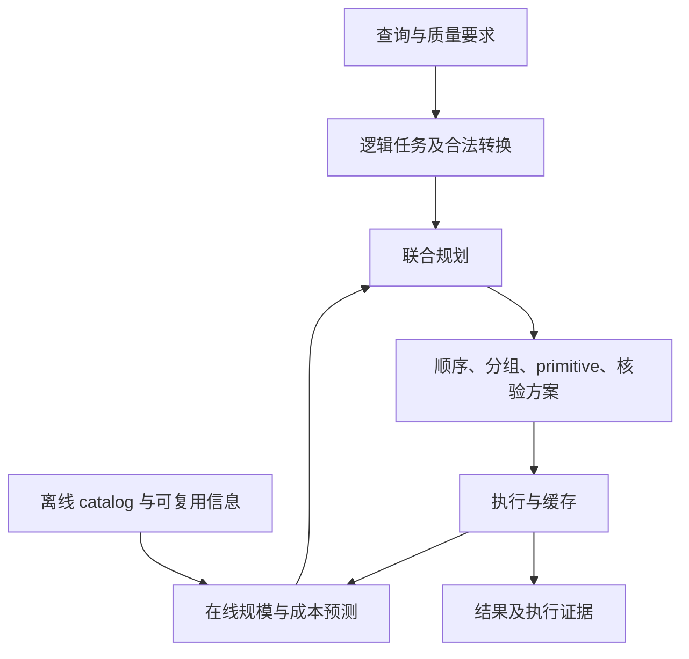

# DM 语义查询优化框架：研究方向、数学对象与验证边界

日期：2026-11-24。状态：本次讨论确定的研究方向；不是已实现系统、已验证方法或冻结的实验协议。

## 1. 本次确定了什么

研究目标从“主要争取 SemCEB 基数估计高分”扩展为：**在满足查询结果质量要求的前提下，联合优化语义查询的执行顺序和模型调用的组织方式，降低端到端执行成本。**

核心问题是：语义判断不必固定实现为“一对记录、一个谓词、一次调用”。能否利用共享上下文、联合配置、排序或其他结构，将多个逻辑判断交给更经济的 DM 调用，并据此重新选择过滤和连接顺序？

本次同意追求这个完整框架，但尚未确定具体规划算法、质量约束、正式评测集和预算。动态规划、启发式搜索、学习成本模型都只是候选手段；不预先声称能够找到全局最优。

### 与已有设计的关系

[原型设计](../designs/2026-11-23-dm-primitives-semantic-join-prototype.md)仍以预算内基数估计为主路径。本讨论记录的是新的研究范围：基数估计成为框架的一项候选能力，而非整个系统的最终交付目标。两份文档的主线目前不同；本次不修改旧设计，也不将其中全部机制自动认定为新框架的既定实现。

已有小切片诊断没有支持当前状态代理的有效性，不能把新方向表述为已有实验已经验证。相关结果保留在[诊断记录](../experiments/2026-11-23-semceb-dm-small-slice-diagnostic-results.md)。

## 2. 首先固定任务语义

### 2.1 记录、谓词与成立结果

令 $R,S$ 为带唯一行标识的关系实例，$r\in R,s\in S$；两者可以是同一基表的不同别名。令 $P$ 表示查询指定的语义谓词，附带允许读取的字段、上下文和参照判定协议。

定义固定参照下的二元标签：

$$
Y_P(r,s)\in\{0,1\}.
$$

这里“二元”指谓词涉及两条记录，不是指模型有两个输出选项。单表过滤是 $Y_F(r)$；多条记录共同参与的谓词可以另行扩展。

参照可以是冻结的模型与提示词协议，或人工标注协议，必须在实验前明确。模型概率与一次实际输出都不自动等于 $Y_P$。若参照本身随机，应规定冻结标签或重复采样协议，不能在推导中默认结果固定、执行中又任意变化。

设允许的候选域为 $\Omega_P\subseteq R\times S$，$N_P=|\Omega_P|$。默认全连接时 $\Omega_P=R\times S$；是否排除对角线、保留方向，必须由查询确定。

$$
\mathcal J_P=\{(r,s)\in\Omega_P:Y_P(r,s)=1\},\qquad
C_P=|\mathcal J_P|,\qquad
\sigma_P=C_P/N_P\quad(N_P>0).
$$

$\widehat C_P$ 表示基数估计。用 $\mathcal J_P$ 表示结果集合，以免与后面的判断次数混淆。

### 2.2 三种任务不能互相替代

| 任务 | 应交付的对象 | 单独知道基数是否足够 |
| :--- | :--- | :--- |
| 基数估计 | $\widehat C_P$ | 是任务本身，但还需评价误差与成本 |
| 完整语义连接 | 匹配记录对集合或其等价表示 | 不足够，需要记录身份及必要的重数 |
| top-k 检索 | 按明确相关性目标选出的前 k 个结果 | 不足够，需要比较或排序信息 |

“谁更相关”是相对判断；“是否满足谓词”是绝对成立性判断。A 胜过 B，不推出 B 不满足条件，也不推出 A 一定满足条件。比赛淘汰的类比可以用于 top-k，但不能直接证明完整连接中的剪枝正确性。

同样，$P_i(r,s)\land P_j(r,s)$ 与 $P_i(a,b)\land P_j(b,c)$ 是不同任务：前者是同一配对的两个条件，后者是三关系链式连接。组合 Qi、Qj 前必须定义别名、变量绑定和数据切片。

## 3. 数学记号：逻辑判断、调用与成本分开计量

### 3.1 三个不同层次

| 符号 | 定义 | 计量单位 |
| :--- | :--- | :--- |
| $e=(P,r,s)$ | 一个二元语义判定项 | 一个逻辑问题 |
| $\mathcal E_2(\pi)$ | 计划 $\pi$ 的某次执行中需解决的二元判定项序列，含重复项 | 判定项序列 |
| $J_2(\pi)=|\mathcal E_2(\pi)|$ | 上述逻辑判定总量 | 次 |
| $U_2(\pi)$ | 上述序列中不同判定项的数量 | 个 |
| $a_t$ | 第 t 次模型调用及其输入、primitive、模型与参数 | 一次物理调用 |
| $M(\pi)$ | 实际模型调用次数 | 次 |
| $D(\pi)$ | 端到端货币或统一资源成本 | 美元或预先规定的单位 |
| $T(\pi)$ | 端到端墙钟延迟 | 秒 |

这些量均针对给定输入和一次执行轨迹；随机性与期望在 §7 定义。若实现不显式展开所有逻辑判定项，$J_2$ 可以由逻辑工作量规则计数，不能因此强迫执行器枚举全部配对。

同一个判定项可能由于中间结果重数被重复需求，故 $U_2\le J_2$。缓存可以减少重复计算，但必须保留连接结果的重数语义。

用户讨论中的 `MC_2(total)` 意在表达二元判断总量。本文建议正式使用 $J_2$，避免将它误解为模型调用数。`MC_global(total)` 若指整个系统资源开销，则对应 $D$ 或 $T$，而不是另一种调用计数。

### 3.2 三者什么时候相等、什么时候不同

若执行阶段仅使用一次 noul 解决一个判定项，不缓存、不重试、不进行额外估计，则执行调用数 $M_{\mathrm{exec}}=J_2$。整个系统的 $M$ 还可能包括估计和规划调用。

若一次调用提供多个判定、缓存复用旧判断，或从合法的结构信息推导关系，则 $M_{\mathrm{exec}}$ 可以小于 $J_2$。反过来，多轮核验和重试也可能使其大于 $J_2$。

因此：**减少 $J_2$、减少 $M$、减少 $D$ 是三个不同的优化目标，不能相互替代。**

### 3.3 为什么单次调用成本不是常数

对调用 $a$，用 $d(a)$ 表示费用或统一资源成本，用 $\ell(a)$ 表示延迟。它们可能受模型、primitive、输入输出长度、选项数量、上下文复用、缓存与服务实现影响。

对 k 个逻辑判定，联合调用的成本记为 $d_{\mathrm{joint}}(k)$。研究假设是某些结构和规模下存在：

$$
d_{\mathrm{joint}}(k)<\sum_{i=1}^{k}d(a_i),
$$

并且输出质量满足同一约束。**这不是默认定律；尤其不意味着任意 k 下联合调用都与一次 noul 等价或等价廉价。**

本讨论中的 MC(1) 可作为一次调用的直观简称，但不能当作所有请求共享的固定资源单位。传统 CPU 比较和模型推理的成本差异，是允许增加廉价计算来减少推理的动机；不主张单次推理必然超过任意规模的全部 CPU 配对计算。

## 4. 两层优化以及它们如何相互影响

### 4.1 逻辑层：短路与顺序选择

对同一 N 个候选上的两个条件，成立数量分别为 $C_i,C_j$。在逐对判断、固定标签、允许短路的假设下：

$$
J_2(i\to j)=N+C_i,\qquad J_2(j\to i)=N+C_j.
$$

不短路需要 $2N$ 次。短路本身不需要基数估计；估计帮助选择两个顺序中的较优者。在单次成本相同的情况下，准确基数对应的较优顺序需要 $N+\min(C_i,C_j)$ 次。

相对较差短路顺序节省 $|C_i-C_j|$，而不是把相对 $2N$ 的全部收益归因于估计。若默认顺序本来正确，估计可能只增加开销。

当单次成本分别为 $t_i,t_j$，应比较 $Nt_i+C_it_j$ 与 $Nt_j+C_jt_i$。当调用允许合并或复用时，这个逐对成本公式又需要更新。

### 4.2 物理层：怎样把逻辑任务组织成调用

物理层决定候选分组、primitive、模型、上下文、结果复用与后续核验。它可能在逻辑判定需求相同的情况下减少调用或总成本。

例如，多项判断共享同一段长商品描述，联合处理可能节省重复输入；一个排序结果可能支持后续多个比较。反过来，选项规模和上下文干扰也可能使联合调用更贵或更不准确。

### 4.3 为什么需要联合优化

最少的逐对判断数量不一定对应最低推理成本。改变 primitive 和分组后，某个中间关系的单位处理成本会变化，原先最好的连接顺序可能不再最好。

局部最优不能直接推出全局最优的原因包括：

1. 调用成本随任务规模非线性变化。
2. 某个动作产出的信息可以被后续多个步骤复用。
3. 估计、规划、缓存维护、重试和补充核验都有成本。
4. 分组和近似会改变错误模式，局部节省可能转化为后续修复成本或结果损失。

我们希望比较的是“顺序与调用组织共同选择”的计划，而不是在固定单价下只最小化候选对数。

## 5. 三种 primitive 的候选角色与合法转换

下面是研究层面的算子设想，不代表当前 API 已支持所有批量格式、概率输出或 score 接口。实现前需核验实际协议。

| primitive | 候选用途 | 必须明确的条件 |
| :--- | :--- | :--- |
| noul | 单个命题 $Y_P(r,s)$ 的判断或概率预测 | 概率定义、阈值、参照与校准；不默认预测正确 |
| choice | 状态分类、联合配置选择、有限排列选择或下一步动作选择 | 选项的语义、互斥性、覆盖性及是否允许多个原始判断同时成立 |
| score | 生成可复用的排序标尺或连续代理 | 分数与原谓词的关系；单标量不自动表示多维偏序 |

### 5.1 联合配置和排列不是一回事

若 k 个二元标签可以任意组合，完整联合配置空间为：

$$
\mathcal Z=\{0,1\}^{k},\qquad |\mathcal Z|=2^k.
$$

选择一项配置可以编码 k 个判断，但选项空间指数增长。三个对象的三个配对判断，对应八种任意真假配置。

若谓词确实由严格全序表达，且没有并列，则 n 个对象的合法排序只有 $n!$ 种；三个对象有六种排列。排序可以导出多个比较，但一般适配、支持、相似关系不能默认具有这一性质。并列或不可比需要不同的输出编码。

若 choice 提供联合配置概率 $p(z\mid x)$，理论上可计算第 j 项的边缘预测：

$$
\widehat p_j=\sum_{z\in\mathcal Z:z_j=1}p(z\mid x).
$$

这只是概率边缘化，并不证明模型概率已校准。若接口仅返回选中配置，不能假装获得了完整分布；若选项没有覆盖所有合法配置，也不能直接使用该式解释原任务。

### 5.2 两层正确性

- **转换正确性**：假设模型完全正确，输出是否足以恢复原查询要求的信息？
- **模型正确性**：在实际输入规模、选项组织和提示词下，模型是否可靠执行了该转换？

前者需要语义条件或数学论证，后者需要实测与质量控制。不能用模型置信度补救一个本身不等价的任务转换。

## 6. 框架总览

候选模块包括：

1. **任务定义层**：固定谓词、变量绑定、字段权限、结果语义和质量目标。
2. **catalog 与估计层**：可复用表示、基数或候选密度估计、调用成本统计。具体表示尚未确定。
3. **转换规则层**：记录每种重组的适用条件、输出信息与回退方式。
4. **规划层**：共同选择执行顺序、数据分组、primitive 和核验策略。
5. **执行层**：保留记录身份、重数、预测与确认状态，复用有效信息并记录调用。
6. **评测层**：计算完整成本与结果质量，区分估计误差、规划失误和模型判断错误。

离线摘要不默认包含未知查询所需的全部信息。查询相关的补充提取和 catalog 构建必须计入在线成本；预处理成本与多查询摊销应分别报告。

## 7. 全局目标、状态与可能的规划方法

### 7.1 成本与质量目标

令 $\Pi$ 为预先规定的合法计划或策略集合。对一次执行，模型调用集合中的每次尝试只计一次费用：

$$
D(\pi)=D_{\mathrm{ordinary}}(\pi)+\sum_{t=1}^{M(\pi)}d(a_t).
$$

模型调用包括估计、规划、执行、核验和失败重试；复用结果不能重复计费。离线成本另报，或按明确工作负载摊销后加入。普通资源若未折算为美元，应单列而非混加不同单位。

延迟 $T(\pi)$ 应按实际调度和关键路径计量；并行执行时不等于各次调用延迟之和。KV 占用属于另一资源维度，若作为目标或约束需单独定义。

令 $L_Q(\pi)$ 为针对任务 Q 预先定义的结果损失，$\varepsilon$ 为允许阈值。一个候选优化目标是：

$$
\pi^*\in\arg\min_{\pi\in\Pi}\mathbb E[D(\pi)]
\quad\text{subject to}\quad
\mathbb E[L_Q(\pi)]\le\varepsilon.
$$

期望应明确对哪些随机性取值：给定数据上的抽样和模型响应，或预先指定的工作负载分布。期望质量约束不保证每个查询都达标；若需要逐查询或高概率保证，必须另行规定。

完整连接可分别限制漏检与误报；top-k 可使用事先指定的排序或答案指标。不能未经约定用一个质量分数覆盖所有任务。上述公式是定义候选目标，不是宣称已能求解。

也可研究 $(D,T,L_Q)$ 的帕累托前沿：没有另一个合法策略在各维度都不差且至少一项更好。不能把“联合优化”直接称为“已达到帕累托最优”。

### 7.2 固定计划与自适应策略

固定计划预先安排算子；自适应策略根据中间结果选择下一动作。候选状态 $s_t$ 可以包含剩余候选、已知判断、概率信息、可复用表示、预算和质量约束状态。动作 $a_t$ 是一次调用或普通计算，输出 $o_t$ 后更新为：

$$
s_{t+1}=\operatorname{Update}(s_t,a_t,o_t).
$$

若状态充分、动作与转移模型已定义，简化的期望成本递推可以写为：

$$
V(s)=\min_{a\in\mathcal A(s)}\left[d(a)+\mathbb E_{o\mid s,a}V(\operatorname{Update}(s,a,o))\right].
$$

该式只说明一种可能的决策形式；质量约束须进入状态、合法动作或终止条件，不会自动由公式满足。状态空间、响应分布和充分性目前都未解决。

传统只按“已连接的表集合”索引的动态规划未必足够：两个计划即使返回同样的记录，也可能积累不同的缓存、排序或概率信息，从而影响未来成本。可以先在有限模板上枚举，再研究动态规划、启发式或学习策略。训练成本模型是候选手段，不是当前已确定的技术路线。

## 8. 分阶段验证与对照

### 阶段一：能力与成本测量

- SemCEB：检验基数估计的精度、费用与延迟，不要求先达到最佳分数才允许研究执行优化。
- primitive 测量：固定任务，改变分组规模、选项数量与共享上下文，比较逐对和联合调用的成本与质量。
- 核心问题：是否存在稳定的优势区域，而不是仅一次调用偶然更便宜？

SemCEB 的位置应事先明确，不能在结果不理想后才改评测目标。更准确的基数不必然选出更好的计划；有误差的估计也可能足以选对顺序。

### 阶段二：有限空间内联合优化

固定任务、允许的转换与计划集合，在小规模上获得枚举参照，然后比较：

| 对照 | 隔离的因素 |
| :--- | :--- |
| 同一个 DM，逐对执行，支持短路 | 避免把换模型或短路本身的收益算作框架贡献 |
| 只优化执行顺序 | 顺序选择的收益 |
| 只优化分组与 primitive | 调用重组的收益 |
| 同时优化两者 | 是否存在联合规划的额外收益 |
| 小规模空间中的事后最优计划 | 衡量规划差距，不作为可免费获得的在线方法 |

完整计入规划和核验成本。不能只比较一个明显不短路的基线，也不能仅比较调用数而忽略请求规模与输出质量。

### 阶段三：端到端执行

在适合的半结构化数据任务上，分别验证完整连接或 top-k 检索的总费用、延迟与结果质量。若增加问答任务，还要区分检索证据质量和最终生成质量。

SemCEB 的主要指标不能替代执行评测；它也不直接提供已核验的所有连接配对标签。关于数据与参考标签边界，见[认识澄清](2026-11-24-semceb-task-data-and-reference-clarifications.md)。正式实验前仍需确认并冻结任务、标签协议、预算、基线和指标。

## 9. 当前最重要的两个待验证假设

**H1：** 对某些常见语义关系和输入规模，具有明确语义编码的联合 DM 调用，能够在相同质量要求下，比逐对 noul 更便宜。

**H2：** 这种调用成本结构会改变较优执行顺序，使顺序与调用组织的联合优化，优于只优化其中一层的方案。

H1 成立而 H2 不明显，仍可能支持一个语义算子执行方法；两者都得到支持，才更有力地支撑完整联合优化系统。当前两者都是研究假设，不是结论。

最终要避免的偏移是：把基数高分当作执行收益、把 top1 淘汰当作完整连接排除、把一次大调用当作固定成本，以及先选复杂优化算法再寻找实际收益。本次方向的中心始终是：**哪些判断可以经济地合并，这种合并如何改变整个查询的执行策略。**

## 10. 补充：传统数据库中的对应思想与我们的研究定位

### 10.1 讨论重点是两层决策的耦合

本次进一步明确：我们关注的不只是固定计划空间上的多目标评分，而是以下相互影响：

> 底层判断的实现或简化方式改变 → 算子的成本与输出特性改变 → 最佳过滤、连接顺序改变 → 联合选择上层结构与底层实现。

因此，“先最小化比较次数，再独立优化比较实现”不保证得到整个查询的最低成本。以逐对判断计量得到的较优顺序，换成共享上下文、联合 choice 或其他物理实现后，可能不再较优。

### 10.2 传统数据库已有逻辑安排与物理实现的联合选择

传统关系型优化器并不只最小化配对比较次数。成本优化器会同时考虑连接顺序、访问路径、嵌套循环、哈希连接、排序合并等实现，并比较完整计划成本。不同实现适合不同输入规模和数据属性，物理实现会反过来影响顺序选择。[Oracle 官方优化器说明](https://docs.oracle.com/en/database/oracle/oracle-database/12.2/tgsql/query-optimizer-concepts.html)

| 决策层 | 传统数据库中的对应对象 | 本框架中的候选对象 |
| :--- | :--- | :--- |
| 上层安排 | 过滤位置、连接顺序 | 语义过滤、连接顺序 |
| 底层实现 | 访问路径、连接算法、辅助过滤 | noul、choice、score、分组与核验 |
| 可复用信息 | 排序属性、物化结果等 | 配对判断、排序、状态与共享上下文 |
| 对计划成本的影响 | 输入规模、数据属性与物理实现共同决定成本 | 任务结构、分组、primitive 和质量要求共同决定成本 |

这种对应是研究定位，不表示这些对象具有相同的正确性条件。传统等价执行计划通常保持精确查询结果，而 DM 的分组或 primitive 变化可能改变判断结果，必须额外定义质量约束。

昂贵谓词的位置选择也有既有研究，例如 [Predicate Migration: Optimizing Queries with Expensive Predicates](https://sigmodrecord.org/1993/06/03/predicate-migration-optimizing-queries-with-expensive-predicates/)。所以“考虑昂贵判断成本”和“联合选择顺序与实现”本身不能作为我们的新贡献。

### 10.3 概率性简化有两种不同的质量含义

一种机制是先用廉价过滤减少昂贵精确判断，保留最终答案的精确性。Bloom filter 是直观例子：在正确构建、包含全部相关键的标准使用条件下，它可以误报可能匹配，但不会将真实成员判为不存在；剩余候选仍需精确核验。构建成本、内存、误报率和核验量共同决定这种过滤是否划算。这个例子说明概率数据结构可以改变物理成本，不表示所有数据库都对其全部参数与连接顺序进行全局联合搜索。

另一种机制允许过滤漏掉成立候选，或者直接接受模型近似判断，此时必须把最终结果损失纳入目标。一般 DM 概率预测不具有 Bloom filter 的单侧错误保证，不能仅因概率低就认为安全排除。

相关研究入口包括 [Filtering with Approximate Predicates](https://chekuri.cs.illinois.edu/papers/filtering.pdf)。该文在这里作为近似谓词过滤的文献线索，尚未完成精读，不据此声称它解决了本文提出的完整联合规划问题。

### 10.4 联合优化与帕累托优化不是同一个概念

可以将一个固定计划的决策展开为：

$$
\pi=(\tau,\mu,\gamma,\theta),
$$

其中 $\tau$ 是逻辑执行结构与顺序，$\mu$ 是各算子的物理实现或 primitive，$\gamma$ 是候选分组规则，$\theta$ 是近似、阈值及核验参数。对自适应策略，这些选择可以依赖执行状态，而不是执行前全部固定。

联合搜索这些决策、只最小化 $D(\pi)$，仍是单目标优化。若同时比较费用、延迟与结果损失，则在这个扩展的计划空间中寻找 $(D,T,L_Q)$ 的非支配集合；§7 的帕累托定义仍然适用。概率机制保持最终精确时，可以只讨论资源之间的权衡；允许最终结果近似时，质量成为另一个权衡维度。

传统多目标查询优化已有近似帕累托前沿的工作，例如 [Approximation Schemes for Many-Objective Query Optimization](https://arxiv.org/abs/1404.0046) 和 [A Fast Randomized Algorithm for Multi-Objective Query Optimization](https://arxiv.org/abs/1603.00400)。这些是可借鉴的方法入口，并不自动解决 DM 的非线性成本、联合输出错误或信息复用问题。

### 10.5 本框架应当主张的区别

本研究的候选贡献应落在：

1. DM primitive 能提供哪些合法、可复核的联合判断编码与替代方式。
2. 这些方式在不同规模和语义结构下具有怎样的成本、质量与信息复用特性。
3. 如何将这些特性纳入规划，并证明其改变了执行选择、带来了端到端净收益。

本节修正“传统数据库主要优化廉价比较与数据搬运”的过度简化。传统优化思想可以作为基础；DM 特有的执行能力与可验证收益，才是我们需要建立的内容。上述文献为讨论中的对应关系与后续阅读入口，本次未进行系统综述，也未确认研究新颖性。
